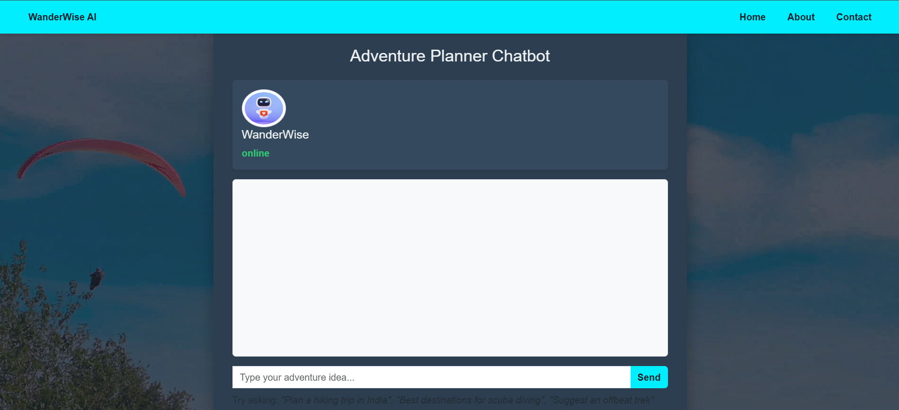
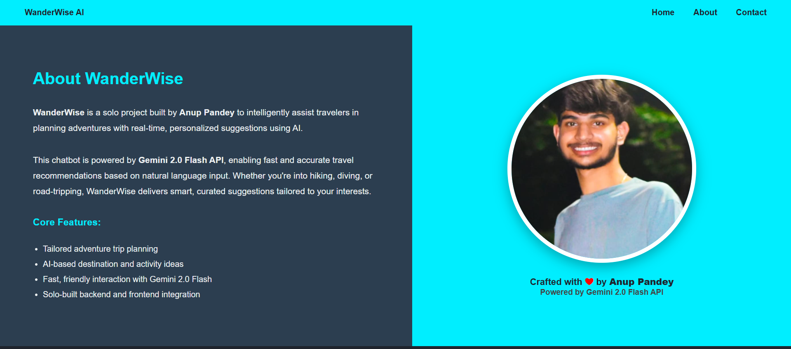
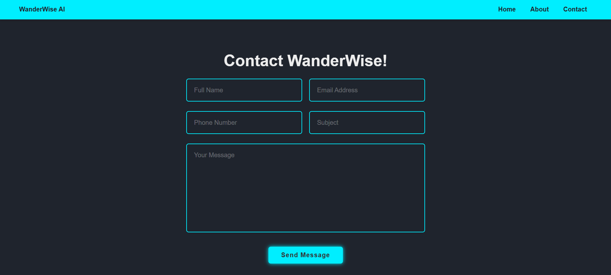

# 🌍 WanderWise AI — Adventure Planner Chatbot & DevOps Project

[](https://nodejs.org/)
[](https://www.docker.com/)
[](https://www.jenkins.io/)
[](https://aws.amazon.com/ec2/)
[](https://developer.hashicorp.com/terraform)
[](https://prometheus.io/)
[](https://grafana.com/)
[](LICENSE)

**WanderWise AI** is an AI-powered adventure planner chatbot that helps travelers discover destinations, explore activities, and create personalized travel itineraries.

This project combines an AI-powered web application with a DevOps workflow using Docker, Jenkins, AWS EC2, Terraform, Prometheus, and Grafana.

## 🌐 Live Demo

**Application:** [WanderWise AI on Render](https://wanderwise-ai-chatbot.onrender.com)

**Source Code:** [GitHub Repository](https://github.com/AnupPandey04/WanderWise-AI---chatbot)

## ✨ Features

- 🧭 Personalized adventure and trip planning
- 🏞️ Destination and activity recommendations
- 🎒 Itinerary suggestions and travel safety tips
- 💸 Budget-conscious accommodation and transport ideas
- 🤖 AI-generated responses using the Google Gemini API
- ✉️ Contact form integration using EmailJS
- 📱 Responsive interface built with Bootstrap, CSS, JavaScript, and EJS
- 🐳 Docker-based application containerization
- 🔄 Automated CI/CD using Jenkins and GitHub Webhooks
- ☁️ AWS EC2 deployment
- 🏗️ Infrastructure as Code using Terraform
- 📊 Infrastructure monitoring with Prometheus, Node Exporter, and Grafana

## 🛠️ Technology Stack

| Category | Technologies |
|---|---|
| Frontend | HTML, CSS, JavaScript, Bootstrap, EJS |
| Backend | Node.js, Express.js |
| AI Integration | Google Gemini API |
| Email Service | EmailJS, SweetAlert2 |
| Containerization | Docker |
| CI/CD | Jenkins, Jenkinsfile, GitHub Webhooks |
| Cloud Infrastructure | AWS EC2 |
| Infrastructure as Code | Terraform |
| Monitoring | Prometheus, Node Exporter, Grafana |
| Version Control | Git, GitHub |
| Application Hosting | Render; AWS EC2 for the DevOps deployment |

## 🏗️ DevOps Architecture

```text
Developer
   |
   v
GitHub Repository (main)
   |
   | GitHub Webhook
   v
Jenkins Pipeline
   |
   +--> Clone Repository
   |
   +--> Build Docker Image
   |
   +--> Stop and Remove Old Container
   |
   +--> Docker Cleanup
   |
   +--> Run Updated Container
   |
   v
AWS EC2 Instance
   |
   v
WanderWise AI Application

Infrastructure Monitoring:
Node Exporter --> Prometheus --> Grafana

Infrastructure as Code:
Terraform --> Existing AWS EC2 Instance
```

### How the DevOps workflow works

1. Code changes are pushed to the GitHub `main` branch.
2. A GitHub Webhook triggers the Jenkins pipeline.
3. Jenkins checks out the repository and builds the Docker image.
4. The pipeline replaces the previous application container with the updated container.
5. The application runs on the EC2 host, with port `80` mapped to container port `3000`.
6. Node Exporter exposes host metrics for Prometheus to collect.
7. Grafana visualizes infrastructure metrics through a Prometheus data source.
8. Terraform tracks the existing EC2 instance through a configuration file and Terraform state.

**Note:** The Render-hosted demo and the AWS EC2 DevOps deployment are separate hosting environments.

## 🔄 Jenkins CI/CD Pipeline

The Jenkins pipeline is defined in the `Jenkinsfile`.

### Pipeline stages

| Stage | Purpose |
|---|---|
| Clone Repository | Checks out the latest code from `main` |
| Build Docker Image | Builds the `wanderwise` image |
| Stop Old Container | Stops and removes the previous container if present |
| Cleanup Docker | Removes unused Docker resources |
| Run Docker Container | Starts the updated container and maps port `80` to `3000` |

The pipeline retrieves the `GEMINI_API_KEY` from Jenkins Credentials rather than storing the API key directly in the Jenkinsfile.

## ☁️ AWS Infrastructure

The application is deployed on an AWS EC2 instance for the DevOps setup.

- **Cloud provider:** Amazon Web Services
- **Region:** `ap-south-1` (Mumbai)
- **Instance type:** `t3.micro`
- **Application container:** Docker
- **Host application port:** `80`

Terraform was used to import the existing EC2 instance into Terraform state and verify the configuration with `terraform plan`.

The current Terraform configuration manages the EC2 instance resource. The referenced VPC, subnet, and security group are not independently managed by this configuration.

## 🏗️ Terraform — Infrastructure as Code

Terraform configuration is maintained in the `terraform/` directory.

```text
terraform/
├── main.tf
├── outputs.tf
├── .gitignore
├── .terraform.lock.hcl
└── README.md
```

### Terraform commands

Initialize the working directory:

```bash
terraform init
```

Import the existing EC2 instance when setting up a new state:

```bash
terraform import aws_instance.wanderwise i-0d386aa85c28be4b9
```

Preview proposed changes:

```bash
terraform plan
```

Apply a reviewed plan when changes are intentionally required:

```bash
terraform apply
```

View configured outputs:

```bash
terraform output
```

The configured outputs include the EC2 instance ID and public IP address.

**Important:** Import the instance only when initializing a new Terraform state. Keep `terraform.tfstate`, its backups, and all credentials out of GitHub. Review plans before applying infrastructure changes.

## 📊 Monitoring with Prometheus and Grafana

Prometheus and Node Exporter collect infrastructure metrics, while Grafana provides dashboards for visualizing them.

The monitoring setup includes host-level information such as:

- CPU utilization
- Memory usage
- Disk usage
- Network activity
- System uptime
- Swap usage

Prometheus collects metrics from Node Exporter, and Grafana queries Prometheus to display the monitoring dashboard.

This setup focuses on **EC2 host and infrastructure monitoring**; it does not currently represent a complete application-level observability system.

## 🚀 Run the Application Locally

### Prerequisites

- Node.js and npm
- A Google Gemini API key
- Git

### 1. Clone the repository

```bash
git clone https://github.com/AnupPandey04/WanderWise-AI---chatbot.git
cd WanderWise-AI---chatbot
```

### 2. Install dependencies

```bash
npm install
```

### 3. Configure environment variables

Create a `.env` file in the project root:

```env
GEMINI_API_KEY=your_google_gemini_api_key_here
```

Replace the placeholder with your own API key. Never commit `.env` or expose API keys publicly.

### 4. Start the application

```bash
node index.js
```

Open [http://localhost:3000](http://localhost:3000) in your browser.

## 🐳 Run with Docker

Build the image from the project root:

```bash
docker build -t wanderwise .
```

Run the container:

```bash
docker run -d \
  --name wanderwise-container \
  -p 3000:3000 \
  -e GEMINI_API_KEY=your_google_gemini_api_key_here \
  wanderwise
```

For production deployments, supply secrets through a secure environment or secrets-management mechanism rather than hardcoding them in commands or source files.

## 📸 Screenshots

Add or retain your application screenshots in the `public/img/` directory.

| Homepage | About | Contact |
|---|---|---|
|  |  |  |

## 💬 Chatbot Persona

> “I'm WanderWise — your intelligent adventure planner. I help you discover destinations, craft personalized itineraries, and make your trips memorable and safe.”

## 🧑‍💻 Author

**Anup Pandey**

B.Tech Computer Science and Engineering

- [LinkedIn](https://www.linkedin.com/in/anup-pandey-/)
- [GitHub](https://github.com/AnupPandey04)
- [Live Application](https://wanderwise-ai-chatbot.onrender.com)

## 🙏 Acknowledgements

- [Google Gemini API](https://ai.google.dev/gemini-api)
- [Node.js](https://nodejs.org/)
- [Express.js](https://expressjs.com/)
- [Bootstrap](https://getbootstrap.com/)
- [EmailJS](https://www.emailjs.com/)
- [Docker](https://www.docker.com/)
- [Jenkins](https://www.jenkins.io/)
- [Amazon Web Services](https://aws.amazon.com/)
- [Terraform](https://developer.hashicorp.com/terraform)
- [Prometheus](https://prometheus.io/)
- [Grafana](https://grafana.com/)
- [Render](https://render.com/)

## 🪪 License

This project is licensed under the MIT License. See the [LICENSE](LICENSE) file for details.
